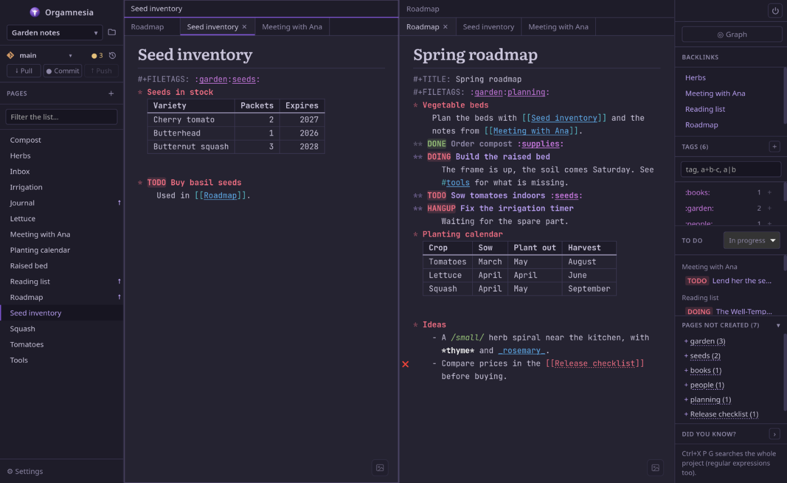
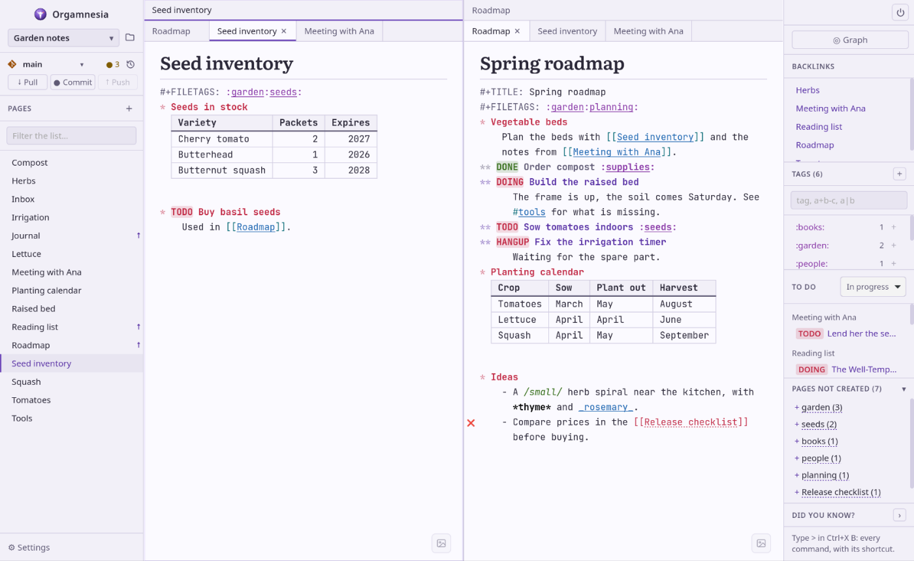
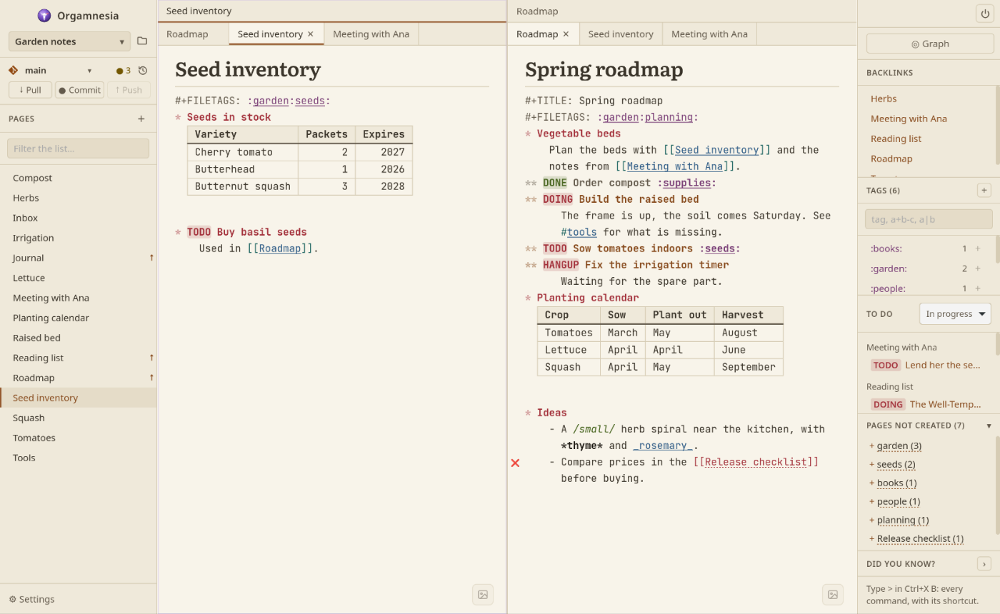
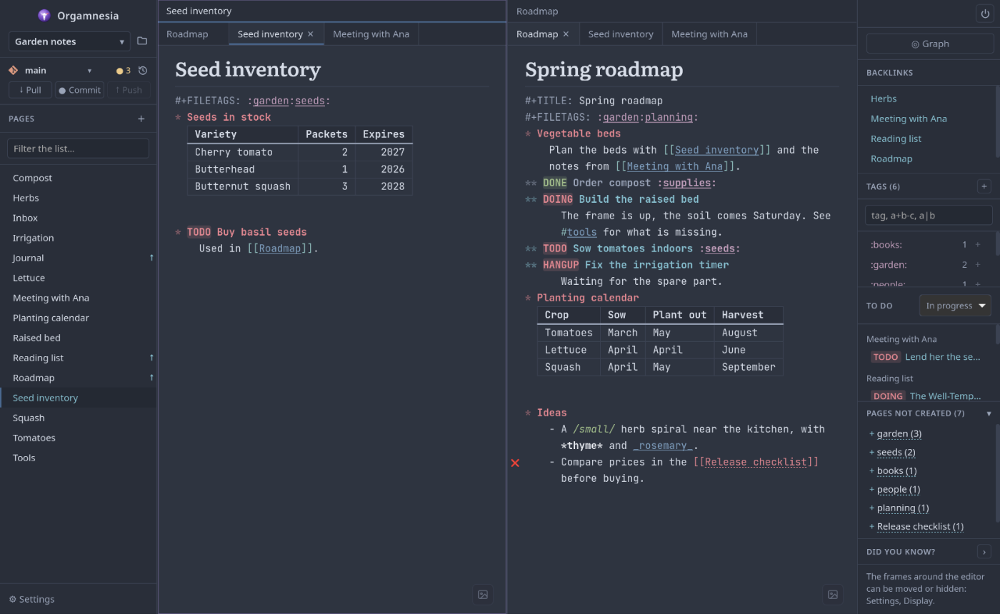
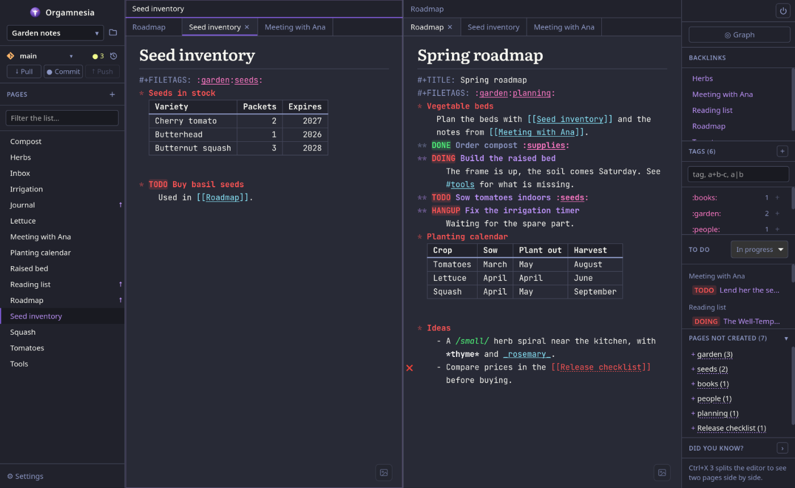

#+TITLE: Orgamnesia

#+HTML: 

*Votre wiki perso, en org-mode ou en Markdown. L'essentiel d'Obsidian, en plus léger.*

*Vos notes restent de simples fichiers. Le reste, c'est du bonus.*

[[https://github.com/thomas-louvigne/orgamnesia/releases/latest][Télécharger]] · [[file:docs/fonctionnalites.org][Toutes les fonctionnalités]] · [[file:readme.org][English]]

#+BEGIN_QUOTE
*Écrite avec une IA (Claude, d'Anthropic).* Relisez le code comme n'importe quelle
contribution.
#+END_QUOTE

* Pourquoi Orgamnesia

- *Vos fichiers, pas les nôtres.* Des =.org= et des =.md= dans le dossier de votre
  choix. Pas de base de données, pas de compte, pas de télémétrie, pas de format
  propriétaire. Emacs, Obsidian, git ou votre outil de synchro les lisent en même temps.
- *Org-mode ou Markdown ? Les deux.* Ils se mélangent dans un projet, et les liens
  =[​[Page]]= marchent partout.
- *Un vrai wiki.* Liens, liens entrants, tags, complétion. Renommez une page : tous
  les liens qui y mènent suivent.
- *Le clavier d'abord.* Un profil Emacs très complet (=C-x C-s=, kill ring, =C-t=,
  =M-q=…) ou un profil Classique, modifiables en entier.
- *Git intégré.* Commit, pull, push, historique d'une page, synchro automatique, sans
  quitter vos notes.
- *Rapide.* Écrit en Rust, lancé en un instant.
- *Libre.* Sous licence [[https://www.gnu.org/licenses/gpl-3.0.html][GPL v3]] : le code est ouvert, à lire, modifier et partager.

* Installer

[[https://github.com/thomas-louvigne/orgamnesia/releases/latest][Téléchargez le fichier de votre système]], puis :

| Système                       | Fichier        | Installation                                     |
|-------------------------------+----------------+--------------------------------------------------|
| Debian, Ubuntu, Mint…         | =.deb=         | =sudo apt install ./Orgamnesia_*.deb=            |
| Arch Linux                    | =.pkg.tar.zst= | =sudo pacman -U orgamnesia-*.pkg.tar.zst=        |
| Tout Linux                    | =.AppImage=    | =chmod +x Orgamnesia_*.AppImage=, puis le lancer |
| macOS 11+ (expérimental)      | =.dmg=         | glisser Orgamnesia dans Applications             |
| Windows 10, 11 (expérimental) | =-setup.exe=   | double-cliquer, puis « Suivant »                 |

*Linux est le seul système utilisé et testé au quotidien.* Les versions macOS et
Windows sont compilées automatiquement, mais pas encore testées sur une vraie
machine : elles peuvent ne pas marcher. Vos retours sont les bienvenus dans les
[[https://github.com/thomas-louvigne/orgamnesia/issues][issues]].

- *macOS* : l'application n'est pas signée et refuse de s'ouvrir la première fois.
  Lancez =xattr -dr com.apple.quarantine /Applications/Orgamnesia.app=, ou passez par
  /Réglages Système › Confidentialité et sécurité › Ouvrir quand même/.
- *Windows* : pas besoin de droits d'administrateur, git est fourni. L'application
  n'est pas signée : sur « Windows a protégé votre ordinateur », cliquez sur
  /Informations complémentaires/ puis /Exécuter quand même/.

Depuis les sources, =main= sur Arch, particularités de macOS et de Windows :
[[file:docs/installation.org][docs/installation.org]].

* En route en une minute

1. *Ouvrez un dossier de notes.* Un dossier existant s'ouvre tel quel ; un nouveau
   reçoit =pages/= et =assets/=.
2. *Créez une page* avec le =+= de la liste des pages.
3. *Tapez* =[​[Autre page]]=. Ctrl+clic l'ouvre, et la crée au besoin.
4. *Ctrl+K* ouvre n'importe quelle page. *F1* liste tous les raccourcis.

* Tout ce qu'il y a dedans

- *Éditeur* : coloration, tableaux dessinés, images et vidéos dans la page, pliage,
  états TODO, cases à cocher, deux volets.
- *Liens* : vers une page, un titre ou une cible, avec aperçu au survol et liste des
  pages à créer.
- *Tags* : =#mots-clés= et =:tags:=, avec recherche combinée.
- *Navigation* : ouverture rapide, toutes les commandes avec =>= dedans, recherche et
  remplacement dans tout le projet (Ctrl+Maj+F), historique des pages, changement de
  projet au clavier.
- *Graphe* (bêta) : les pages et leurs liens en 3D.
- *Cadres* : pages, liens entrants, tags, à faire, git, astuces… placés où vous voulez.
- *Thèmes* : Nuit, Jour, Fjord, Papier, Dracula, ou le vôtre en un fichier CSS.
- *Export* d'une page en PDF ou en HTML, *site statique* avec
  [[https://github.com/thomas-louvigne/org-bloom][org-bloom]].
- *Orthographe* : fautes soulignées, suggestions au clic droit, dictionnaire
  personnel (Hunspell).
- *Filet de sécurité* : sauvegarde automatique, corbeille avec annulation, pages
  modifiées ailleurs rechargées.
- *Réglages en texte* : du JSON ouvert dans l'éditeur, vérifié pendant la frappe,
  appliqué à chaud, avec historique.
- *Interface* en français et en anglais, *mises à jour* signées depuis l'application.

|  |  |
| Jour                               | Papier                               |
|  |  |
| Fjord                              | Dracula                              |

Le détail, avec tous les raccourcis : [[file:docs/fonctionnalites.org][docs/fonctionnalites.org]].

* Vos données

- *Les pages* : les fichiers =.org= et =.md= de votre dossier. C'est tout.
- *Aucune télémétrie.* Le réseau ne sert qu'aux mises à jour (désactivable), à git et
  aux vidéos ou images en ligne de vos pages.
- *Les réglages* : des fichiers JSON à versionner si vous voulez, =settings.json= et
  =keybindings/<nom>.json=. Une option absente prend sa valeur par défaut. Ils sont
  dans =~/.config/com.orgamnesia.app/= (Linux),
  =~/Library/Application Support/com.orgamnesia.app/= (macOS) ou
  =%APPDATA%\com.orgamnesia.app\= (Windows).

* Développer

Rust de bout en bout : Tauri v2 (=src-tauri/=), Leptos 0.7 compilé en WebAssembly
(=src/=), et =core/= pour ce qu'ils partagent.

#+BEGIN_SRC sh
cargo tauri dev     # lancement avec rechargement à chaud
cargo test --lib    # tests (aussi dans src-tauri/ et core/)
#+END_SRC

Installer les outils et publier une version : [[file:docs/installation.org][docs/installation.org]].

* À venir

- [ ] Tester la version Windows
- [ ] Tester sur macOS
- [ ] Paquet dans l'AUR pour Arch Linux
- [ ] Paquet dans les dépôts Debian
- [ ] Raccourcis clavier vi
- [ ] Second cerveau avec l'IA : un modèle de =CLAUDE.md= à poser dans un projet, pour qu'un agent (Claude Code…) comprenne les pages, les liens, les tags et les TODO
- [ ] Serveur MCP : chercher, lire, rétroliens, tags, TODO et créer des pages depuis Claude Desktop, Claude Code ou un autre client
- [ ] Mentions non liées : les pages qui citent la page ouverte sans lien, avec un bouton pour lier
- [ ] Capture rapide dans une page Inbox, et une revue de la semaine (pages modifiées, TODO ouverts)

* Licence

[[https://www.gnu.org/licenses/gpl-3.0.html][GNU GPL v3]] ou ultérieure. Voir [[file:LICENSE][LICENSE]].
