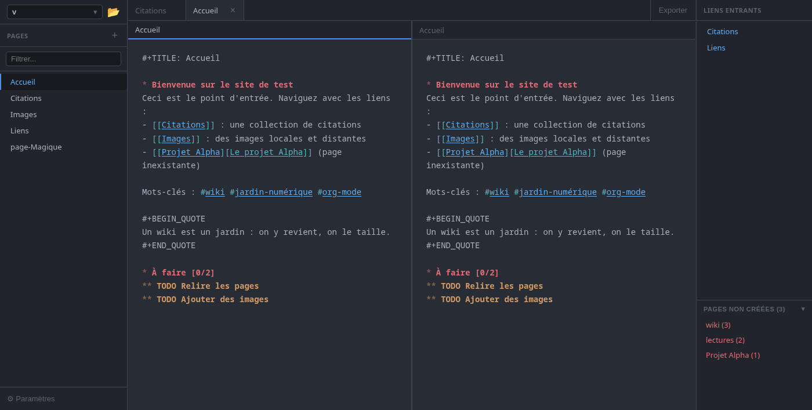

#+TITLE: Orgamnesia

#+HTML: 

*Un wiki perso à la sauce =org-mode= : l'essentiel d'Obsidian en plus léger.*

/[[file:readme.org][English version]]/

#+BEGIN_QUOTE
*Bêta, écrit avec une IA.* Des bugs et des changements sont à prévoir : gardez une
copie de vos fichiers =.org=. Le code a été écrit avec l'aide de Claude (Anthropic) ;
relisez-le comme n'importe quelle contribution.
#+END_QUOTE

* Pourquoi Orgamnesia

- *Vos notes restent de simples fichiers =.org=* dans le dossier de votre choix :
  pas de base de données, pas de format propriétaire. Emacs, git ou un outil de
  synchro peuvent les lire en parallèle.
- *Des pages liées*, comme dans un wiki : liens =[[Page]]=, liens entrants, tags.
- *Léger* : une application de bureau native écrite en Rust, rapide à lancer.

* Fonctionnalités

- *Nouveau projet en un clic* : un dossier créé avec =pages/= et =assets/=, prêt
  à écrire ; un dossier de fichiers =.org= existant s'ouvre tel quel.
- *Liens et tags* : =[[Page]]=, =#mots-clés= et =:tags:=, avec complétion ;
  renommer une page réécrit les liens qui y mènent.
- *Cadres* autour de l'éditeur : pages, liens entrants, tags, à faire, git…, placés
  à votre guise.
- *Ouverture rapide* (Ctrl+K) et *recherche et remplacement dans le projet*
  (Ctrl+Maj+F).
- *Éditeur org-mode* : coloration, tableaux, états TODO, niveaux des titres, deux
  volets, raccourcis Emacs ou Classique.
- *Correcteur d'orthographe* : fautes soulignées, suggestions au clic droit,
  dictionnaire personnel (dictionnaires Hunspell).
- *Corbeille* avec annulation, *sauvegarde automatique*, pages modifiées par un
  autre programme rechargées.
- *Extensions* : état git, site web statique avec
  [[https://github.com/thomas-louvigne/org-bloom][org-bloom]].
- Interface en français et en anglais.

Toutes les fonctionnalités en détail : [[file:docs/fonctionnalites.org][docs/fonctionnalites.org]].

* Prise en main

1. Lancez Orgamnesia et *créez un projet* (un nouveau dossier, préparé avec =pages/=
   et =assets/=), ou *ouvrez un dossier* qui contient déjà des fichiers =.org=.
2. *Créez une page* avec le bouton =+= de la liste des pages.
3. Tapez =[[Autre page]]= pour faire un lien vers une autre page ; Ctrl+clic
   l'ouvre, et la crée au besoin.
4. Ctrl+K ouvre n'importe quelle page ; F1 liste tous les raccourcis.

* Installation

Téléchargez le fichier de votre système sur la
[[https://github.com/thomas-louvigne/orgamnesia/releases/latest][page des versions]] :

| Système                  | Fichier            | Installation                                     |
|--------------------------+--------------------+--------------------------------------------------|
| Debian, Ubuntu, Mint…    | =.deb=             | =sudo apt install ./Orgamnesia_*.deb=            |
| Arch Linux               | =.pkg.tar.zst=     | =sudo pacman -U orgamnesia-*.pkg.tar.zst=        |
| Tout Linux               | =.AppImage=        | =chmod +x Orgamnesia_*.AppImage=, puis le lancer |
| macOS 11+ (non testé)    | =.dmg=             | glisser Orgamnesia dans Applications             |

*macOS* : l'application n'est pas signée, donc macOS refuse de l'ouvrir la première
fois. Autorisez-la une fois avec
=xattr -dr com.apple.quarantine /Applications/Orgamnesia.app=, ou par
/Réglages Système › Confidentialité et sécurité › Ouvrir quand même/.

Windows n'est pas pris en charge pour le moment.

Compiler depuis les sources, la dernière version de =main= sur Arch, et les
particularités de macOS (dictionnaires, touches Cmd et Option) :
[[file:docs/installation.org][docs/installation.org]].

* Vos données

- Les pages : les fichiers =.org= du dossier du projet.
- Les réglages : =~/.config/com.orgamnesia.app/= sous Linux,
  =~/Library/Application Support/com.orgamnesia.app/= sous macOS.

* Développement

Application de bureau en Rust : Tauri v2 (backend, =src-tauri/=) et Leptos 0.7
(interface compilée en WebAssembly, =src/=) ; =core/= contient ce qu'ils partagent.

#+BEGIN_SRC sh
cargo tauri dev     # lancement avec rechargement à chaud
cargo test --lib    # tests (aussi dans src-tauri/ et core/)
#+END_SRC

Installer les outils : [[file:docs/installation.org][docs/installation.org]].

* TODO-LIST

- [ ] Tester sur macOS
- [ ] Paquet dans l'AUR pour Arch Linux
- [ ] Paquet dans les dépôts Debian
- [ ] Expressions régulières dans les recherches
- [ ] Raccourcis clavier vi
- [ ] Gestion des thèmes

* Licence

[[https://www.gnu.org/licenses/gpl-3.0.html][GNU GPL v3]] ou ultérieure. Voir [[file:LICENSE][LICENSE]].
