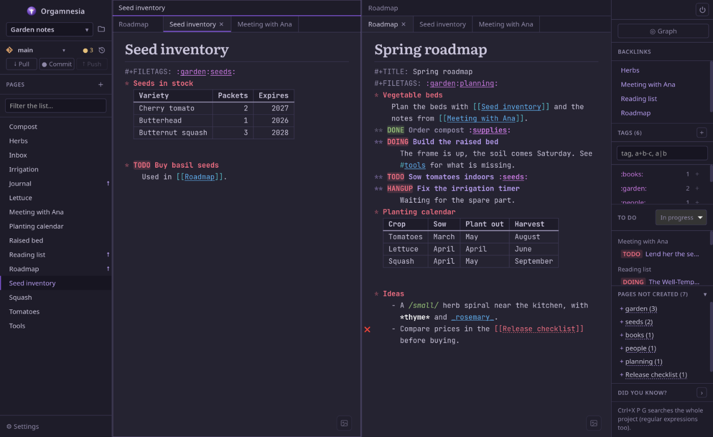

#+TITLE: Orgamnesia

#+HTML: 

*Your personal wiki, in =org-mode= or Markdown. The essentials of Obsidian, lighter.*

*Your notes stay plain files. Everything else is a bonus.*

[[https://github.com/thomas-louvigne/orgamnesia/releases/latest][Download]] · [[file:docs/features.org][All the features]] · [[file:readme.fr.org][🇫🇷 Français]]

#+BEGIN_QUOTE
*Beta, written with AI (Anthropic's Claude).* Expect bugs and changes. Keep a copy of
your notes, and review the code as you would any other contribution.
#+END_QUOTE

* Why Orgamnesia

- *Your files, not ours.* =.org= and =.md= files in a folder you choose. No database,
  no account, no telemetry, no proprietary format. Emacs, Obsidian, git or your sync
  tool read them alongside.
- *Org-mode or Markdown? Both.* They mix in a project, and =[[Page]]= links work
  everywhere.
- *A real wiki.* Links, backlinks, tags, completion. Rename a page: every link to it
  follows.
- *Keyboard first.* A very complete Emacs profile (=C-x C-s=, kill ring, =C-t=,
  =M-q=…) or a Classic one, both fully rebindable.
- *Git built in.* Commit, pull, push, page history, automatic sync, without leaving
  your notes.
- *Fast.* Written in Rust, up in an instant.
- *Free software.* Licensed under the [[https://www.gnu.org/licenses/gpl-3.0.html][GPL v3]]: the code is open, to read, change and share.

* Install

[[https://github.com/thomas-louvigne/orgamnesia/releases/latest][Download the file for your system]], then:

| System                        | File           | Install                                       |
|-------------------------------+----------------+-----------------------------------------------|
| Debian, Ubuntu, Mint…         | =.deb=         | =sudo apt install ./Orgamnesia_*.deb=         |
| Arch Linux                    | =.pkg.tar.zst= | =sudo pacman -U orgamnesia-*.pkg.tar.zst=     |
| Any Linux                     | =.AppImage=    | =chmod +x Orgamnesia_*.AppImage=, then run it |
| macOS 11+ (experimental)      | =.dmg=         | drag Orgamnesia to Applications               |
| Windows 10, 11 (experimental) | =-setup.exe=   | double-click, then "Next"                     |

*Linux is the only system used and tested day to day.* The macOS and Windows versions
are built automatically but not yet tested on a real machine: they may not work.
Feedback is welcome in the [[https://github.com/thomas-louvigne/orgamnesia/issues][issues]].

- *macOS*: the app is not signed and refuses to open the first time. Run
  =xattr -dr com.apple.quarantine /Applications/Orgamnesia.app=, or go through
  /System Settings › Privacy & Security › Open Anyway/.
- *Windows*: no administrator rights needed, git comes with the app. It is not
  signed: on "Windows protected your PC", click /More info/, then /Run anyway/.

From the sources, =main= on Arch, macOS and Windows particulars:
[[file:docs/install.org][docs/install.org]].

* Up and running in a minute

1. *Open a folder of notes.* An existing one opens as is; a new one gets =pages/= and
   =assets/=.
2. *Create a page* with the =+= of the list of pages.
3. *Type =[[Other page]]=.* Ctrl+click opens it, and creates it if needed.
4. *Ctrl+K* opens any page. *F1* lists all the shortcuts.

* What's inside

- *Editor*: highlighting, drawn tables, images and videos in the page, folding, TODO
  states, checkboxes, split view.
- *Links*: to a page, a headline or a target, with a preview on hover and the list of
  pages to create.
- *Tags*: =#keywords= and =:tags:=, with combined search.
- *Navigation*: quick open, project-wide search and replace (Ctrl+Shift+F), page
  history.
- *Frames*: pages, backlinks, tags, to do, git… placed where you want.
- *Export* of a page as PDF or HTML, *static site* with
  [[https://github.com/thomas-louvigne/org-bloom][org-bloom]].
- *Spelling*: misspelled words underlined, suggestions on right click, your own
  dictionary (Hunspell).
- *Safety net*: autosave, trash with undo, pages changed elsewhere reloaded.
- *Settings as text*: JSON opened in the editor, checked as you type, applied at once,
  with a history.
- *Interface* in French and English, signed *updates* from inside the app.

Every detail, with all the shortcuts: [[file:docs/features.org][docs/features.org]].

* Your data

- *Pages*: the =.org= and =.md= files in your folder. That's it.
- *No telemetry.* The network is only used for updates (can be turned off), git, and
  the online videos or images in your pages.
- *Settings*: JSON files you can keep under version control, =settings.json= and
  =keybindings/<name>.json=. A missing option takes its default value. They live in
  =~/.config/com.orgamnesia.app/= (Linux),
  =~/Library/Application Support/com.orgamnesia.app/= (macOS) or
  =%APPDATA%\com.orgamnesia.app\= (Windows).

* Develop

Rust from end to end: Tauri v2 (=src-tauri/=), Leptos 0.7 compiled to WebAssembly
(=src/=), and =core/= for what they share.

#+BEGIN_SRC sh
cargo tauri dev     # run with hot reload
cargo test --lib    # tests (also in src-tauri/ and core/)
#+END_SRC

Setting up the tools and releasing a version: [[file:docs/install.org][docs/install.org]].

* Coming next

- [ ] Test on Windows
- [ ] Test on macOS
- [ ] Package in the AUR for Arch Linux
- [ ] Package in the Debian repositories
- [ ] Regular expressions in searches
- [ ] Vi keybindings
- [ ] Theme management

* License

[[https://www.gnu.org/licenses/gpl-3.0.html][GNU GPL v3]] or later. See [[file:LICENSE][LICENSE]].
